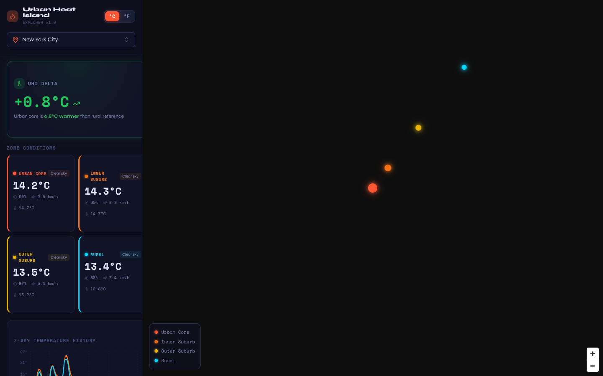

# Urban Heat Island Explorer

Compares live air temperature in a city centre with points progressively further out (inner suburb, outer suburb, rural) to show the urban heat island effect for 25 cities.

**Live:** https://urban-heat-island-explorer.vercel.app



## What it shows

- Current conditions for four sample points per city, fetched in parallel from Open-Meteo
- The UHI delta: urban core temperature minus the rural reference
- A 7-day hourly temperature history per zone and an hour-by-day heat grid
- °C / °F toggle and a city search

## How it works

- Sample points are offset diagonally from the city centre by 0, 0.05°, 0.15° and 0.30°. This is a simple approximation; it does not use land-cover data, so some "rural" points can land on water or another town.
- Open-Meteo is a modelled product (roughly 1–11 km grid depending on region), so the deltas are indicative and smaller than what station or satellite land-surface temperature would show.
- State lives in a small Zustand store; requests are cached with TanStack Query.

## Stack

React · Vite · MapLibre GL (react-map-gl) · Recharts · Zustand · TanStack Query · Tailwind CSS · shadcn/ui

## Run locally

```bash
bun install   # or npm install
bun run dev
```

No API key is needed.

## Ideas for improvement

- Place the reference points using land-cover data (ESA WorldCover) instead of fixed offsets
- Add MODIS / Landsat land-surface temperature as a raster layer for comparison
